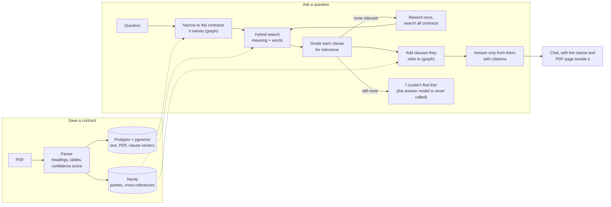

# Jurion

Ask questions about your contracts and get answers you can check. Every claim in an answer links to the exact clause and PDF page it came from, shown beside the answer with the clause highlighted.

Jurion is a retrieval-augmented generation (RAG) system for legal contracts, built to show where a plain "search, then ask an AI" setup breaks on real contracts and what fixes each break. The **Problems & fixes** tab in the app tells that story in plain English; the **Evaluation** tab measures it.

## How it works



- **Postgres is the source of truth** (text, PDFs, vectors, users). **Neo4j holds only the links** and can be rebuilt from Postgres at any time.
- **Stack:** FastAPI, PostgreSQL + pgvector, Neo4j, Redis (rate limits), React + Vite + Tailwind, PyMuPDF, OpenAI (embeddings, grading, answers), Alembic, pdf.js.

## What is in the app

| Tab | What it does |
|---|---|
| **Ask** | A chat with your contracts. Streaming answers, citations that open the clause beside the answer, history of every question. |
| **Search** | Hybrid search (meaning + keywords) with the rank and score behind each result, and a 2D/3D map of your clause embeddings. |
| **My contracts** | Saved contracts, with embeddings, the graph and the clause list for each. |
| **Parser Lab** | Upload a PDF and see how it was cut into clauses, with a confidence score and an AI fallback. |
| **History** | Every question and search, kept. Two can be compared side by side. |
| **Evaluation** | The question set and the measured results (below), question by question. |
| **Problems & fixes** | The real problems found, in plain English, with the numbers. |
| **Parser report** | Parser test results on 510 public contracts. |

## Measured results

From the latest runs: 83 questions (77 with an answer) over **15 public contracts**, 847 clauses (see the Evaluation tab for the live numbers and the question-by-question detail):

| | Result |
|---|---|
| Right clause in the top 5 results: meaning only / words only / hybrid / + heading context / + widened by the graph | 77% / 18% / 77% / 78% / 79% |
| Right clause inside the clauses Ask gives the grader: no narrowing / hard / soft narrowing | 88% / 90% / 92% |
| Answers that cite the right clause (95.5% when the library was 5 contracts) | 84.4% |
| Claims supported by the clauses given | 99.1% |
| Unanswerable questions correctly refused | 6 of 6 |
| Answers that are confident but from the wrong clause (4.5% on 5 contracts) | 6.5% |

**Read these honestly:** accuracy fell when the library tripled, because there are more look-alike clauses (the same 44 questions: 95.5% on 5 contracts, 84.1% on 15). Part of that drop is generic questions that now have several valid answers in different contracts while the test accepts one. The set is still small (one question is about 1.3 points), answers differ slightly between runs, and faithfulness is scored by an AI judge. The graph fixed the failures it was built for (questions that name a contract) and left overall search quality about the same. [`docs/18-evaluation.md`](docs/18-evaluation.md) records what was tried, what did not work, and the bugs found in the measuring itself.

## Run it

```bash
docker compose up -d postgres neo4j redis        # the three databases
cd backend && cp .env.example .env               # then fill in ENCRYPTION_KEY and the Google client ID (docs/06-auth.md)
uv sync && uv run uvicorn app.main:app --reload  # API on :8000 (applies the database migrations on start)
cd frontend && cp .env.example .env && npm install && npm run dev   # app on :5173
```

Then sign in, press the key icon in the top bar and save an OpenAI key (it is stored encrypted), upload a contract in the Parser Lab, save it, and ask a question on the Ask tab.

## Tests

```bash
cd backend && uv run python -W ignore -m tests.run_all    # 10 suites against real Postgres, Redis and Neo4j; OpenAI calls are faked
uv run python -W ignore -m tests.eval_qa                  # retrieval evaluation (needs a saved OpenAI key; a fraction of a cent)
uv run python -W ignore -m tests.eval_answers             # answer-quality evaluation (a few cents)
```

GitHub Actions runs the backend suites against service containers and the frontend type check, lint and build on every push (`.github/workflows/ci.yml`).

## Known limits

- Scanned PDFs are read by OCR when Tesseract is installed (mostly-scanned documents of up to 20 scanned pages; otherwise they go whole to the AI). OCR text can contain recognition errors, and the result says so. On the public test contracts, most of the 37 that parsed badly came from a few layouts that are now handled; the rest have not been looked at one by one.
- Company names are normalised ("Acme Corp." = "Acme Corporation Inc.") but nicknames are not resolved ("Acme Group" stays a separate company).
- The evaluation set is small and was written by one person after reading the contracts.
- Contract text is sent to OpenAI for embeddings, relevance checks, party extraction and answers. Keep sensitive contracts out, or run with a model you host.
- Cross-reference widening has one clear rescue on 6 questions I designed to need it. That is encouraging, not proof.

## Docs

Start with [`docs/README.md`](docs/README.md). The most useful: [Ask](docs/15-ask.md), [Evaluation](docs/18-evaluation.md), [the graph](docs/12-graph.md), [operations](docs/19-operations.md), and the [5-minute demo script](docs/21-demo-script.md).
