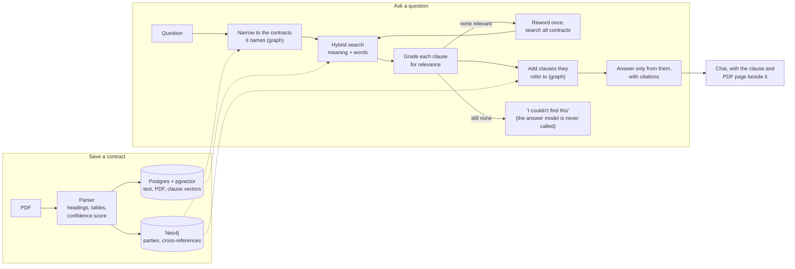

# Jurion

Ask questions about your contracts and get answers you can check. Every claim in an answer links to the exact clause and PDF page it came from, shown beside the answer with the clause highlighted.


_The same demo as an [MP4](demo/jurion-demo.mp4) (1 MB). Two questions on the test contracts in `demo/test-contracts/`: the follow-up names no contract and stays in the same one._

Jurion is a retrieval-augmented generation (RAG) system for legal contracts, built to show where a plain "search, then ask an AI" setup breaks on real contracts and what fixes each break. The **Problems & fixes** tab in the app tells that story in plain English; the **Evaluation** tab measures it.

## How it works



- **Postgres is the source of truth** (text, PDFs, vectors, users). **Neo4j holds only the links** and can be rebuilt from Postgres at any time.
- **Stack:** FastAPI, PostgreSQL + pgvector, Neo4j, Redis (rate limits), React + Vite + Tailwind, PyMuPDF, OpenAI (embeddings, grading, answers), Alembic, pdf.js.

## What is in the app

| Tab | What it does |
|---|---|
| **Ask** | A chat with your contracts. Streaming answers, citations that open the clause beside the answer, and memory for follow-up questions within a session. |
| **Search** | Hybrid search (meaning + keywords) with the rank and score behind each result, and a 2D/3D map of your clause embeddings. |
| **My contracts** | Saved contracts, with embeddings, the graph and the clause list for each. |
| **Graph** | A three-pane explorer of companies, contracts and clauses, with impact analysis and similar clauses. |
| **Parser Lab** | Upload a PDF and see how it was cut into clauses, with a confidence score and an AI fallback. |
| **Sessions** | Chats live in the sidebar under Ask. Each remembers its earlier questions and has its own context limit (rename, delete, new session). |
| **Evaluation** | The question set and the measured results (below), question by question. |
| **Problems & fixes** | The real problems found, in plain English, with the numbers. |
| **Parser report** | Parser test results on 510 public contracts. |

## Measured results

Latest full run (`results.json`, 10 Nov 2026): 83 questions (77 with an answer) over a library of **28 contracts**: 22 public ones with look-alikes (several services agreements, a distributor agreement with two amendments, a duplicate development agreement) plus 6 realistic test contracts. The Evaluation tab shows the live numbers and the question-by-question detail.

| | Result |
|---|---|
| Right clause in the top 5 results: meaning only / words only / hybrid / + heading context / + graph | 73% / 18% / 74% / 75% / 73% |
| Right clause in the top 10 with the graph (all 77 / the 6 linked-clause questions) | 88% / 100% |
| Answered (did not refuse) | 93.5% |
| Answers that cite the right clause | 81.8% (95.5% on 5 contracts, 87.0% on 15) |
| Answers that are confident but from the wrong clause | 13.0% (4.5% on 5 contracts, 9.1% on 15) |
| Claims supported by the clauses given (AI judge) | 97.1% |
| Unanswerable questions correctly refused | 6 of 6 |

**Read these honestly.** Accuracy fell as the library grew (5, then 15, then 28 contracts), because more contracts means more look-alike clauses, and many generic questions ("Which courts have jurisdiction over disputes?") now have several valid answers while the test accepts one. The set is small (one question is about 1.3 points), answers vary between runs by up to about 13 questions, and faithfulness is scored by an AI judge. The graph fixed the failures it was built for (questions that name a contract) and left overall search quality about the same. The "Which contract?" step is switched off in these runs; measured separately, the router flags 23% of the evaluation questions (31% before it was tightened), mostly ones that name no contract. An earlier README quoted a 22-contract column (79.2% cited, 13.0% wrong clause) whose run was overwritten in `results.json`; it is replaced by this re-run. [`docs/18-evaluation.md`](docs/18-evaluation.md) records what was tried, what did not work, and the bugs found in the measuring itself.

## Run it locally

**You need:** Docker (for the three databases), [uv](https://docs.astral.sh/uv/) (it installs Python 3.14 for you), Node 20+, a Google OAuth client ID for sign-in ([`docs/06-auth.md`](docs/06-auth.md); add `http://localhost:5173` as an authorised JavaScript origin), and an OpenAI API key. Tesseract is optional (OCR for scanned PDFs).

**1. Start the databases** (Postgres with pgvector, Neo4j, Redis):

```bash
docker compose up -d postgres neo4j redis
```

**2. Configure and start the API** (port 8000; it applies the database migrations on start):

```bash
cd backend
cp .env.example .env
uv sync
uv run python -c "from cryptography.fernet import Fernet;print(Fernet.generate_key().decode())"   # paste the output as ENCRYPTION_KEY in .env
# also set GOOGLE_CLIENT_ID in .env; the database settings already match docker-compose.yml
uv run uvicorn app.main:app --reload
```

**3. Configure and start the app** (port 5173), in a second terminal:

```bash
cd frontend
cp .env.example .env          # set VITE_GOOGLE_CLIENT_ID to the same client ID
npm install
npm run dev
```

**4. Use it.** Open <http://localhost:5173>, sign in with Google, click the key icon in the top bar and save your OpenAI key (stored encrypted, per user). Then:

1. **Parser Lab**: drop in the PDFs from `demo/test-contracts/` (six realistic contracts; regenerate them with `cd backend && uv run python ../demo/make_test_contracts.py`). Several at once are parsed and saved in turn.
2. **My contracts**: each saved contract shows `Embedded` and `Graph` once ready.
3. **Ask**: try "Can Northwind terminate the BrightPath master services agreement for convenience, and with how much notice?" (90 days), then the follow-up "How fast must they report a breach?" in the same session.

**Check that it is up:** `curl localhost:8000/health` should report `postgres_vector`, `neo4j` and `redis` as true; the status pill in the app's header says "All systems online".

**Stop:** Ctrl+C in both terminals, then `docker compose down` (add `-v` to also delete the data).

**If something fails**
- *"Port already in use"*: another Postgres, Neo4j or Redis is on 5432, 7687 or 6379; stop it or change the port mapping in `docker-compose.yml` and the matching URL in `backend/.env`.
- *Google sign-in button errors*: the client ID is missing in one of the two `.env` files, or `http://localhost:5173` is not an authorised origin.
- *The app says the backend is offline*: the API is not running, or the databases are still starting (wait a few seconds and press "Check again" in the header pill).
- *Ask answers "I couldn't find this"*: no key saved (key icon), or the contract has no embeddings yet (My contracts, the sparkle button).
- *Reset everything*: `docker compose down -v`, then start again from step 1.

### Workflow vs agent (Ask has both modes)

`gpt-4o-mini` for both, 3 repeated runs each (lowest to highest), 16 multi-step questions added to the 83 above. The agent stays **opt-in** (`ASK_DEFAULT_MODE=workflow`): it did not meet the bar set beforehand, see [`docs/22-agentic-ask.md`](docs/22-agentic-ask.md).

| | Workflow | Agent |
|---|---|---|
| 83 original questions: cite the right clause | 79% to 80% | 73% (all 3 runs) |
| 83 original questions: confidently wrong | 13% to 16% | 13% to 17% |
| 16 multi-step questions: cite every needed clause | 63% to 69% | 75% to 88% |
| Compare two contracts / name a company first (n=5 each): found | 40% to 60% / 80% | 100% / 100% |
| Median model calls / tokens per answer | 3 / about 5,900 | 4 / about 8,100 |
| Median / slowest-1-in-10 time | 11 s / 14 s | 8 s / 12 s |

The agent is clearly better when an answer needs clauses from two places and worse on plain lookups (paraphrased questions, whole-section questions, questions that name a contract). Small sets: 16 questions is about 6 points each.

## Tests

```bash
cd backend && uv run python -W ignore -m tests.run_all    # 10 suites against real Postgres, Redis and Neo4j; OpenAI calls are faked
uv run python -W ignore -m tests.eval_qa                  # retrieval evaluation (needs a saved OpenAI key; a fraction of a cent)
uv run python -W ignore -m tests.eval_answers             # answer-quality evaluation (a few cents)
```

GitHub Actions runs the backend suites against service containers and the frontend type check, lint and build on every push (`.github/workflows/ci.yml`).

## Known limits

- Scanned PDFs are read by OCR when Tesseract is installed (mostly-scanned documents of up to 20 scanned pages; otherwise they go whole to the AI). OCR text can contain recognition errors, and the result says so. On the public test contracts, most of the 37 that parsed badly came from a few layouts that are now handled; the rest have not been looked at one by one.
- Company names are normalised ("Acme Corp." = "Acme Corporation Inc.") but nicknames are not resolved ("Acme Group" stays a separate company).
- The evaluation set is small and was written by one person after reading the contracts.
- Contract text is sent to OpenAI for embeddings, relevance checks, party extraction and answers. Keep sensitive contracts out, or run with a model you host.
- Cross-reference widening has one clear rescue on 6 questions I designed to need it. That is encouraging, not proof.

## Docs

Start with [`docs/README.md`](docs/README.md). The most useful: [Ask](docs/15-ask.md), [Evaluation](docs/18-evaluation.md), [the graph](docs/12-graph.md), [operations](docs/19-operations.md), and the [5-minute demo script](docs/21-demo-script.md).
